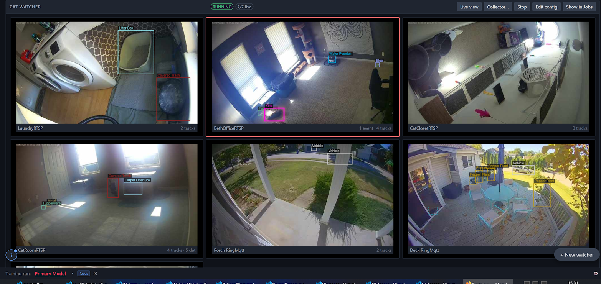
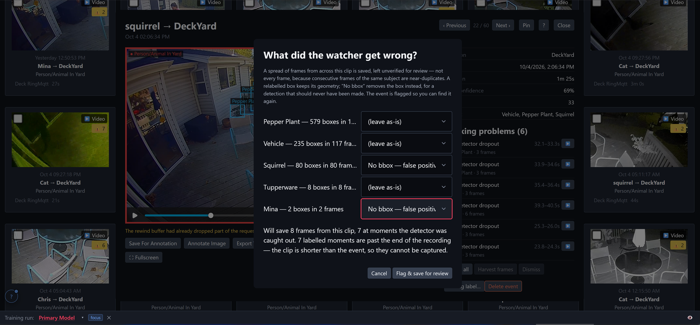
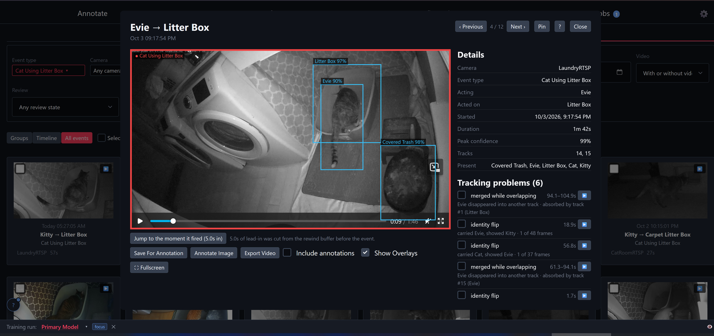
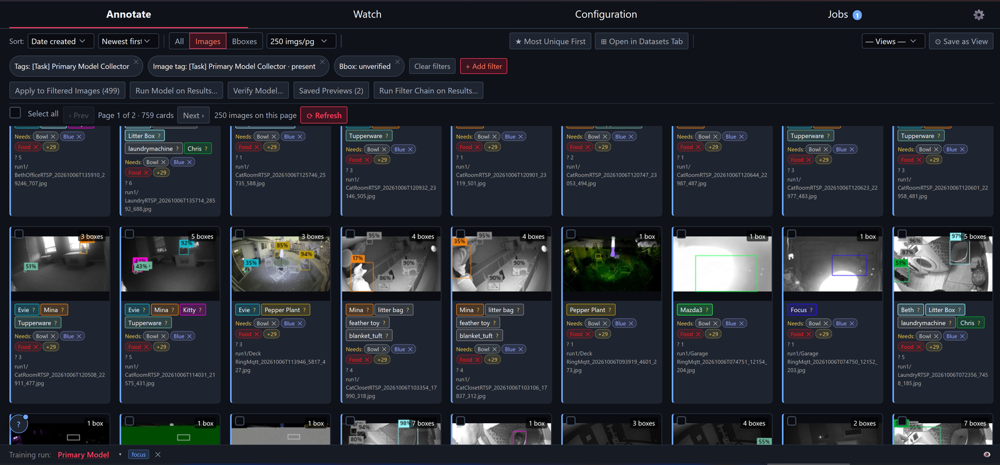
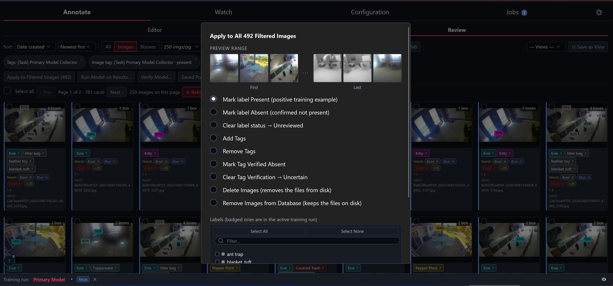
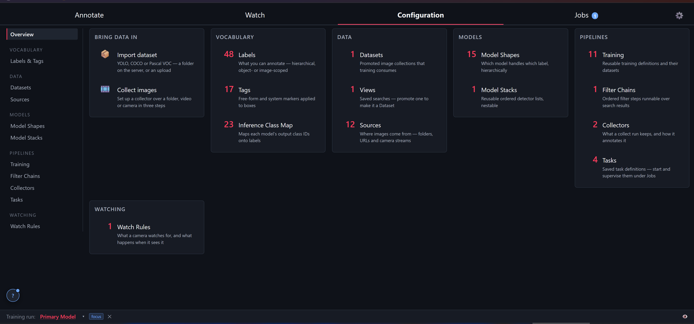
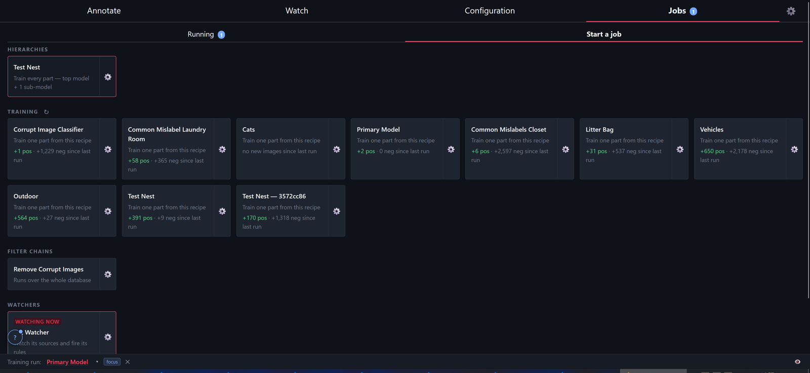
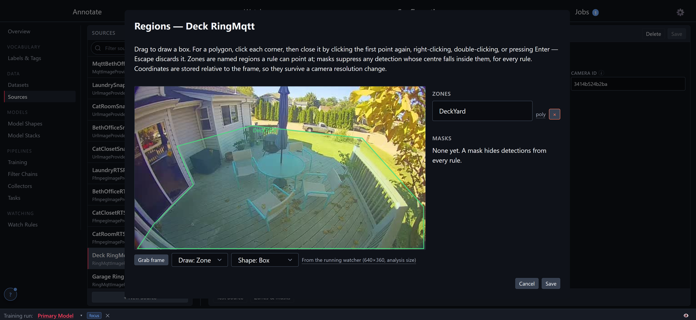
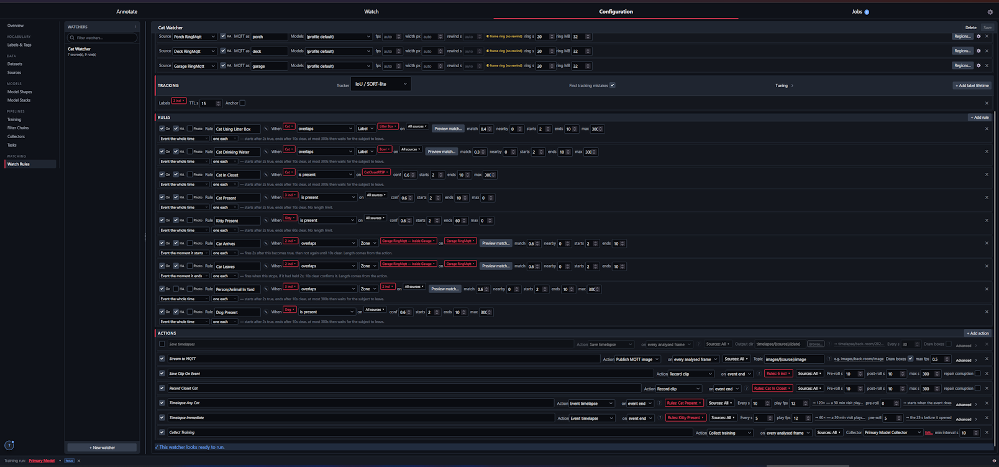
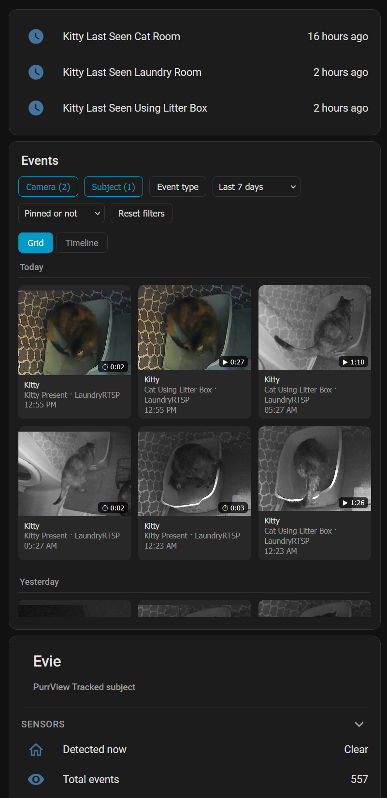

# PurrView

> **Just want to get it running?** → [Getting started](#getting-started)

PurrView watches camera streams, tracks the objects in them, and raises an event
when one object interacts with another. A package arriving on the porch. The mail
truck reaching the mailbox. Which bowl a specific cat eats from. If a model can
detect it, you can write a rule about it meeting something else and have Home
Assistant hear about it.

It is the successor to [Yolo2Mqtt](https://github.com/cobryan05/Yolo2Mqtt), which
did this job well. What it did not do was make the upkeep easy, and a detection
model is nearly all upkeep.

## The problem

Four cats in one house, all free feeding. At the vet, the simple questions are
unanswerable: is each cat eating, is each cat drinking, is each cat using the
litter box? The best anyone can say is that food disappears and the litter gets
soiled, but not which cat is responsible.

Cheap cameras pointed at the bowls and the litter boxes, plus a YOLO model
trained to tell the individual cats apart, answers all of it. Yolo2Mqtt did
exactly that, and ran unattended for years.

What it could not do was keep up. Cats left and new ones arrived. The house
changed. The bowls were replaced. Each of those meant the model was answering
questions about a house that no longer existed, and fixing it meant collecting
and labelling images by hand all over again — enough work, every time, that it
kept being put off, and the training data fell further and further behind.

That is the real problem with this kind of project. Getting a model working once
is a weekend. Keeping it current for years is the part that quietly doesn't
happen.

## The solution

PurrView does the same job, but the maintenance is built into the app instead of
being left as an exercise. Collecting training data, labelling it, defining
sources and rules, training a model and putting it back into service are all
things the app does, because they are the things you will do over and over.

The short version of what it gives you:

- **Sources.** RTSP and anything else ffmpeg can pull, ring-mqtt, snapshot URLs,
  whole images published to an MQTT topic, and video files or local devices
  through OpenCV.
- **Rules about overlap.** An object meeting a zone drawn on the camera — a
  parcel inside the porch, a car in the garage — or an object meeting another
  object, which is the harder and more useful case. Bowls can be moved around the
  room instead of being fixed trigger windows.
- **Events.** Each one can cut a video clip including the seconds before it
  started, compress a long visit into a short timelapse, save a snapshot, publish
  to MQTT, and publish an annotated live frame as a Home Assistant camera.
- **Training data that collects itself.** While the cameras are watching, a
  collector keeps a capped, deduplicated queue of frames that are actually worth
  labelling — the ones the model was unsure about, or where it nearly confused
  one label for another.
- **Training wherever it is fastest.** The training server can run on a different
  machine from the one watching the cameras. An NVR box can train; a gaming PC
  will do it faster.
- **Filtering.** Thousands of events and tens of thousands of frames are only
  useful if you can cut them down to the handful that matter and then act on all
  of them at once. Filters work on absence as well as presence, which is usually
  the more interesting question: clips of a dog with no person present, or images
  where a label has never been confirmed either way.



*Watch → Live: every camera in a running watcher, with what it is tracking right
now.*

## Keeping the model from decaying

This is the part that matters, and the rest of the app is arranged around it.

1. A **watcher** runs a model — or an ordered stack of them — over a camera
   stream and tracks what it finds.
2. A **rule** turns tracked objects into an **event** ("cat overlaps the litter
   box for at least 2 seconds"), which cuts a clip out of the rolling buffer.
3. The clip replays with per-frame boxes drawn on it, so you can see what the
   model actually saw.
4. You tell it **what it got wrong**. Per label: leave it alone, relabel it, or
   mark it a false positive that should not have been a box at all. That saves a
   spread of frames from across the clip into the image database, left unverified
   for review, and flags the event so you can find it again. This is the one you
   will use most — usually what a model gets wrong is a label, and this fixes a
   whole visit's worth of them in one dialog.
5. When the fault is in the **tracking** rather than the labelling, the same clip
   lists its tracking problems — a dropped detection, an identity flip between
   two subjects, two tracks merging while they overlap — each with a button that
   jumps the video to the moment it happened.
6. You annotate the harvested frames, promote a search into a **dataset**, and
   **train**.
7. The new model goes back into the watcher.



*Step 4 — correcting an event label by label, and the frames that correction will
harvest.*



*Steps 3 and 5 — the clip with its boxes, and the tracking problems found in it.*

None of this is mandatory, and it does not all have to run on one machine. The
training node talks to the rest only over HTTP, so it can run on a faster box or
be left out entirely.

## Adding a new class without ruining your old data

This is the part that is easy to get wrong, and it is worth understanding before
the dataset gets large.

Training data has to say what is in an image *and* what is not. A box says
"present". Nothing at all does not say "absent" — it says "nobody has looked".
Those are very different things, and a model trained on the second one learns the
wrong lesson.

The consequence shows up the first time you add a class. Say the model has been
detecting cats for a year, and now you want it to detect vehicles. Every old image
with a car in the driveway and no vehicle box is now actively teaching the model
that cars are background. Train on it and vehicle detection will be worse than if
you had never added the class.

So every image carries a per-label state: **present**, **absent**, or
**unreviewed**. A label counts as settled on an image when there is a verified box
for it, or an explicit "not in this picture". Until then it is a gap, and every
review card lists its own gaps for whichever training run is active, as `Needs:`
chips. Training knows the difference between an image that has been checked for a
label and one that has not.

Confirming absence sounds like a lot of work. Three things make it quick:

- **Multi-select and hotkeys** for working through images by hand, which is fast
  enough to be unremarkable once you have the keys memorised — or rebound to
  whatever you would rather they be, under Settings → Keyboard Shortcuts.
- **Filter, then bulk apply**, for everything obvious. There are no vehicles in
  the basement, so filter to the basement camera and mark vehicle *absent* across
  the whole result set in one action. Most of a backfill is this.
- **Let a model do the looking** for the cases where the class genuinely might be
  in the old images. Put the new class in a model of its own, train it, then
  filter to the old data and *run model on results*. It finds the instances and
  you confirm what it found, instead of eyeballing thousands of frames. At
  detection time the two models run together as a stack, so splitting a class out
  this way costs nothing at runtime.

That last point is most of the reason model stacks exist. A class that arrives
later does not have to be retrofitted into the model that came before it.

## What it looks like

### Watch

**Live** is one card per camera per watcher: the current frame, what is tracked
right now, which rules are open, and how the stream is being ingested. Each
camera has a switch for whether it is being watched, and turning it off while
the watcher runs hands back its stream lease rather than just skipping it.
Changing which sources a watcher *has* is a config edit, and needs a restart.
If the watcher is running a collector, the card is also where you reach that
collector's statistics and the queue of frames it has kept.

**Events** is the recorded history. Events group into sessions — one visit,
however many times the rule re-fired during it — and each card carries its clip
or timelapse. Clips play with the detection boxes drawn on them, read from a
`<clip>.mp4.boxes.json` sidecar written alongside the video.

Filter by camera, event type, what was acting, what was acted on, what was merely
present, review state or time — and every one of those can exclude as well as
include. "Clips of a dog on the deck camera with no person present" is a filter,
not a search you have to do by eye.

### Annotate

**Editor** is a canvas for drawing boxes, a file browser, and a sidebar with
labels, inference and tags. It is the obvious place to annotate, and it is not
where most annotating actually happens.

**Review** is. It is the bulk surface, and the one that makes a large database
usable. Filter by label, tag, confidence range, source or filename pattern, and
by whether a label is present, confirmed absent, or has never been looked at —
that last one is how you find the gaps a new class left behind. Find visually
similar images by perceptual hash, or deliberately dissimilar ones. Run a model,
a classifier or a filter chain over the results. Promote a search into a dataset.

The reason the work happens here is that you can keep going without leaving.
Open an image from a result grid and it comes up on a canvas in a modal, with the
same tools the Editor has. Pick a box in it and search for images containing
something similar, and those results open in another modal on top. Drill into one
of those and annotate it. Each layer keeps its own filters and its own selection,
ESC walks back out one at a time, and the stack is managed properly — only the
topmost dialog dims the background, so five levels deep does not fade to black.

In practice a session looks less like opening images one after another and more
like following a thread: find the frames a model is confusing, correct them where
you found them, and come back up.

Boxes can also be copied between images, which matters more than it sounds like
it should. Most of what a fixed camera sees does not move: the food bowl, the
litter box, the water fountain are in the same place in every frame for months.
Draw them once, copy them, and paste them into the next image — then you are only
drawing the thing that actually moved. Coordinates are stored proportionally, so
a paste works across images of different sizes, and pasting a box that is already
there is a no-op rather than a duplicate. The clipboard is shared by every canvas
on the page, so you can copy on one and paste inside a modal three levels down.



*Annotate → Review: filter chips across the top, bulk actions beneath, images and
boxes as cards.*

Anything you can filter down to, you can act on in one go — mark a label present
or absent across the whole result set, add or remove tags, settle verification, or
delete. The dialog shows the range it is about to touch first. This is the tool
that makes backfilling a new class across an existing dataset bearable.



*"Apply to all" — the first and last images of the range, the operations, and a
label picker that badges whatever is in the active training run.*

### Configuration

| Group | Holds |
|---|---|
| **Vocabulary** | Labels (hierarchical, object- or image-scoped), tags, and the per-model map from class IDs onto labels |
| **Data** | Datasets (what training consumes), Views (saved searches, promotable to datasets), Sources |
| **Models** | Model Shapes (which model handles which label, hierarchically) and Model Stacks (ordered detector lists, nestable) |
| **Pipelines** | Training definitions, filter chains, collectors, saved task definitions |
| **Watching** | Watch Rules — what a camera watches for, and what happens when it sees it |



*Configuration → Overview. The two shortcuts at the left skip the setup grind:
import an existing YOLO, COCO or Pascal VOC dataset, or point a collector at a
folder, a video or a camera.*

### Jobs

Everything long-running is a task: training, collection, import, classification,
filter chains, model conversion, frame harvesting, and the watchers themselves.
**Running** shows what is in flight and lets you pause, cancel or inspect it.
Tasks persist their state, so a watcher survives a restart.

**Start a job** is mostly a board of your trained models. Every training recipe
you have defined gets a card, and each one is a single click to retrain. The
useful part is what the card tells you before you click: how many new positive
and negative training images have been added since that model last trained. A
model sitting at "no new images since last run" has nothing to gain from
retraining. One showing a few hundred new examples probably does.



*Jobs → Start a job. Each card is one model and one click; the counts underneath
are how much new annotated data has arrived since it last trained. Collectors,
filter chains and watchers are launched from the same page.*

### Settings

Service health, retention for recordings and timelapse frames (age and size caps,
with a "clean up now"), model-version and training-folder retention, the
thumbnail cache, dedup hash sizes, the MQTT broker, and optional access control:
an API token for Home Assistant and other callers, plus a separate login password —
off by default, stored only as a hash — for signing in to the web interface.

## How watching works

**Sources and ingest.** A source is a URL. PurrView works out how to ingest it and
tells you which tier it landed in, because they do not cost the same:

| Tier | Meaning |
|---|---|
| `native` | MediaMTX pulls it directly (RTSP, RTMP, SRT, HLS …). Cheapest. |
| `ffmpeg` | Needs an ffmpeg front end. Copies the codec where it can; transcodes, which is real per-camera CPU, only when it must. |
| `ring` | Ring cameras, which are event-driven rather than continuous. |
| `none` | Snapshot only. No rewind timeline. |

Buffered tiers get a rolling buffer in RAM (tmpfs `/buffer`, with MediaMTX
recording into it). That buffer is what makes pre-roll possible: an event that
starts now can still include the fifteen seconds before it.

Not every source is a continuous stream. A snapshot URL, a topic someone publishes
whole JPEGs to, and a video file or local device opened through OpenCV are all
valid sources. They land in the `none` tier, so they are watched and they fire
rules, but there is no rewind window to cut a clip out of. An MQTT image topic in
particular may go quiet for days and be working perfectly, so it has no read
timeout unless you give it one.

**Models.** A watcher has a default detector, and any camera on it can override
that if it needs something different — a yard camera and a litter-box camera can
share a model, or not. A model stack is an ordered list of models run together,
and stacks nest, so "the general detector plus the one trained on your own
subjects" is a single entry rather than a copy-paste into every watcher. When two
models in a stack both claim the same
label on overlapping boxes, a merge policy decides which survives, and a more
specific label always beats a coarser ancestor regardless of which model produced
it.

**Model Shapes** are the other axis: which model owns which label, hierarchically,
so a coarse detector can find "cat" and a second-level model can then say which
cat. It works, but it is the less travelled path. In practice a single flat list
of classes — one per individual cat, rather than a `Cat` parent refined by a
sub-model — trained better and was simpler to maintain, so that is the arrangement
actually in use. The nested case is correspondingly less well tested.

**Regions.** Regions are drawn once per camera, not per watcher, because the
geometry describes the camera's view rather than any one watcher's opinion of it.

- A **zone** does nothing until a rule names it. A box called "litter box area" is
  more reliable than a litter-box detector and needs no training data at all.
- A **mask** acts on everything. Any detection whose centre falls inside it is
  suppressed.



*The region editor, grabbing a frame from the running watcher. Coordinates are
stored relative to the frame, so they survive a camera resolution change.*

**Rules.** A rule is a sentence: subject, relation, target, plus timing.

Subjects and targets are labels (optionally including their child labels), zones,
anything, or nothing. The relations:

| Relation | Use it for |
|---|---|
| `present` | The subject is tracked at all. |
| `contains` | How much of A is inside B. Right for a cat in a litter box, where the boxes are very different sizes. |
| `overlaps` | Intersection over the *smaller* box. Right for a cat drinking from a bowl, where neither contains the other. |
| `iou` | Intersection over union. Right for two objects of similar size. |
| `centroid_in` | A's centre is inside B. Cheap and robust. |
| `distance` | Normalised centre distance. "Cat near the door." |
| `motion` | Pixels changed. The one relation that fires on a frame with no detections at all. |

Timing is three numbers. `min_duration_s` is the dwell, how long the predicate
must hold before it counts. `rearm_delay_s` is the debounce, how long it must be
clear before the event ends or can fire again. `max_duration_s` caps a long one.

Triggers decide *when* a rule fires. `while` spans the predicate and is the usual
choice. `on_enter` and `on_exit` are instants rather than spans — "the car left
the garage, but only if it had been there fifteen minutes" has no duration to
record, and the footage worth keeping is on either side of the moment, which is
what pre-roll and post-roll already do.

Granularity decides *how many* events open at once: one per tracked object, which
makes two cats at the same bowl two visits, or one per rule for as long as anyone
matches, which is right when the recording is of the whole scene anyway.

**Actions** are what actually happens when a rule fires. Each hangs off a rule
transition (`event_started`, `event_ended`, `track_started`, `object_detected`) or
off every analysed frame, and each is scoped to rules and sources. One rule
watched on five cameras can record on the camera pointed at the litter box and
stay silent on the other four.

| Action | What it does |
|---|---|
| **Record clip** | Cuts real time out of the rolling buffer, with pre-roll and post-roll, so the seconds before the event started are in the file. |
| **Event timelapse** | Samples a frame every N seconds while the event is open and compiles one mp4 at the close. Two hours of a cat in a window, in ten seconds. A clip cannot do this: a clip is real time, and the buffer never held two hours. |
| **Save snapshot** | One image at the moment the event began, written as the analysis frame with a JSON sidecar, so it can be curated into training data later. |
| **Save timelapse** | One frame every N seconds all day, into browsable per-day folders at the camera's own resolution. For a human to scrub through, not for training. |
| **Publish MQTT** | The event edge as a message: start, update, end. Not retained, because replaying "event started" to every new subscriber is a bug rather than a feature. |
| **Publish MQTT image** | The current frame with boxes drawn on it, retained and keyed by camera rather than by rule. This is what makes a Home Assistant camera entity show something the instant it subscribes. |
| **Collect training images** | Hands the watcher's own frames to a collector, at watcher cadence. |
| **Save event** | Nothing outward at all. It files the event in the Events view, for a rule whose other actions produce nothing to attach, or that has none. |

Output paths and MQTT topics are templated — `{source}`, `{rule}`, `{subject}`,
`{target}`, `{phase}`, `{date}`, `{hour}` and others — and the editor renders the
template against example values as you type, so a typo shows up there rather than
on the broker.



*Configuration → Watch Rules. Each rule row is the sentence; each action row below
says what happens and when.*

**Collectors** are what keep the training data from going stale, and they are the
main thing PurrView has that Yolo2Mqtt did not. A collector is a standing
instruction about which frames are worth saving, and a watcher can run one
continuously in the background:

- A **confidence band** per label, not just a floor. "Save this one between 0.3
  and 0.7" is the uncertain middle where there is something to learn, rather than
  the confident frames that are already right.
- **Ambiguity**: save a detection whose runner-up label came too close to the
  winner. This is how you catch one subject being mistaken for another, which is
  the whole problem in a multi-cat house.
- **Perceptual-hash dedup** on the whole image and on each box, so hours of a cat
  asleep in the same spot do not become hours of near-identical frames.
- A **capped review queue**, so it cannot quietly fill the disk. Over the cap it
  evicts the oldest, the least visually unique, or whatever keeps the labels
  balanced — but frames the model was confused about, and frames nobody has looked
  at yet, are given up last, because those are the scarcest thing in the queue.

> ⚠️ Eviction deletes images. The cap is a real ceiling on how much unreviewed
> data a collector will keep, not a pause. Review what you want to keep, or raise
> the cap.

A collector running as a watcher action stays reachable while it works. The
**Collector…** button on the watcher's card in Watch → Live opens its tuning
surface: live dedup statistics and the sweep tables for picking a threshold, how
close the confusable detections actually were, counts of detector misses and
novel frames — and, in the same place, a button that browses the unverified
frames it has kept. Seeing what a knob did and looking at the images it produced
are one click apart rather than two tabs apart. The queue it opens is the same
Review surface as everywhere else, so you can label from it directly.

**Trackers** are plugins; ByteTrack and an IoU/SORT-lite tracker ship. The
detection confidence floor is deliberately low, because a tracker needs the weak
boxes to associate across frames. The rule's own match threshold is where to
tighten things up, not the detector's.

## Home Assistant

Two channels, because neither is enough on its own.

**MQTT discovery.** An app-level bridge publishes device-based discovery for the
app, each watcher, each rule, each camera and each tracked subject, so states and
counts arrive as real entities with real history: detected now, total events, last
seen in the laundry room. Set the broker under Settings → MQTT.

**A custom integration** for the things MQTT is the wrong shape for: an events
browser with its own camera, subject, event-type and date filters, media proxied
through Home Assistant rather than handed out as raw URLs, and live camera
entities fed by `publish_mqtt_image` actions.

Flagging goes the other way. Home Assistant can mark an event's labels as wrong,
and it shows up in the Events pane as something to fix.



*Maple can't keep it in the box. Last-seen sensors and pre-filtered events browser on a page in
 Home Assistant let us know when it's been too long since the last time Maple used the litter.*


## Architecture

One Python codebase (`apps/`) exposed as several FastAPI services, run together by
supervisord:

| Service | Port | Role |
|---------|------|------|
| `image_tagging_server` | 7999 | Web UI. A pure proxy and SPA host, no business logic |
| `inference_server` | 8001 | ONNX inference (YOLOv5/v7/v8), GPU pinning with auto-unload |
| `tasks_server` | 8002 | Long-running jobs, including the watchers |
| `db_server` | 8003 | SQLite store, thumbnails, search |
| `stream_server` | 8004 | Owns mediamtx: camera fan-out, leases, the buffer, clip extraction |
| `training_server` | 8005 | Training. Optional, GPU |

Those collapse into two images. **`app`** is the frontend plus inference, built
slim and CPU-only by default — no CUDA, no torch, inference is pure ONNX at
runtime — and optionally built on a CUDA base for GPU inference. **`training`** is
the heavy torch/ultralytics node: optional, always GPU, and standalone, since it
talks to the frontend only over HTTP and can therefore live on another box.

## Getting started

You need Docker with the Compose v2 plugin. For any GPU deployment you also need
an NVIDIA GPU, current drivers, and the
[NVIDIA Container Toolkit](https://docs.nvidia.com/datacenter/cloud-native/container-toolkit/latest/install-guide.html).
CPU-only deployments need none of the NVIDIA pieces. An MQTT broker is only
needed for the Home Assistant side.

```bash
git clone https://github.com/cobryan05/purrview.git
cd purrview

./setup.sh                     # answer a few questions, writes .env
docker compose up -d --build
```

The UI is at **http://localhost:7999**.

`setup.sh` detects whether there is a GPU and asks what this host should run
(everything, frontend and inference only, training only, or a dev workspace), then
writes `.env`. Even on a GPU host it offers CPU inference, which is worth taking
if you would rather keep the frontend slim or reserve the VRAM for training.
Compose reads `.env` automatically from then on. Re-run `./setup.sh` to change
your mind.

### Letting it see your files

The app only sees what Docker hands it. By default that is five directories from
the repo: `./data` (the database and recordings), `./models`, `./image_datasets`
(every image the app knows about), `./conf` and `./logs`.

Anything else on the host is invisible to it. A folder of photos you want to
import, a NAS share of existing camera footage, a directory some other program
drops images into — none of that can be read until it is bind mounted in. That
goes in `docker-compose.override.yml`, next to the compose file. It is gitignored
and compose merges it automatically, so it is the right home for anything
specific to your machine:

```yaml
services:
  mono:                                   # or app / mono-dev / app-dev,
    volumes:                              # whichever profile you are running
      - /mnt/nas/camera-archive:/app/image_datasets/archive:ro
      - /srv/photos:/app/image_datasets/photos:ro
```

Mount under `/app/image_datasets` and the contents turn up where you would expect
them: the file browser, the dataset importer, and a collector pointed at a folder.
`:ro` is worth adding for anything you only ever import *from*.

Run `docker compose up -d` again after editing it. A path that is not mounted does
not exist as far as the app is concerned, which is the usual explanation for a
folder picker that cannot see your images.

### Your first model

Once it is up, the path from empty database to something useful is roughly this.
Expect the labelling to be the slow part; everything else is quick.

1. **Add a source.** Configuration → Sources. An RTSP URL, a ring-mqtt camera, a
   snapshot URL, an MQTT image topic, or a video file. Use *Test source* to
   confirm frames arrive before going further.
2. **Decide on labels.** Configuration → Labels & Tags. A class for each thing
   you want to tell apart. Labels can be hierarchical, though a flat list of
   individuals is the better-tested arrangement — see
   [what to expect](#what-to-expect).
3. **Collect images.** Configuration → Overview → *Collect images* walks it in
   three steps. Point it at the source and let it run while the thing you care
   about actually happens. If you already have a labelled dataset, *Import
   dataset* takes YOLO, COCO or Pascal VOC instead.
4. **Label them.** Annotate → Review for the bulk work, Annotate → Editor for
   individual images. Draw boxes for what is there, and mark what is *not*
   there — that second half matters more than it sounds like it does, and
   [Adding a new class](#adding-a-new-class-without-ruining-your-old-data)
   explains why.
5. **Train.** Configuration → Training to define a run, then Jobs → Start a job
   to launch it. A first pass on a few tens of images is enough to see whether
   the idea works at all.
6. **Write a watch rule.** Configuration → Watch Rules. Add the source, pick the
   model, and write the rule as a sentence: subject, relation, target, plus how
   long it has to hold. Draw a zone on the camera first if the rule needs one.
7. **Attach actions.** On the same page — record a clip, publish to MQTT,
   collect training images. Nothing happens without at least one action, or a
   *Save event* action if you only want it to appear in the Events view.
8. **Start it.** Jobs → Start a job → the watcher. Watch → Live shows what it is
   seeing, and Watch → Events fills up as rules fire.
9. **Point Home Assistant at it.** Settings → MQTT for the broker; entities
   appear through discovery.

Then the loop above: correct what it got wrong, harvest those frames, retrain.
The first model will not be very good. That is expected, and fixing it is the
part the app is built for.

### Topologies

`setup.sh` maps your answers onto these. You can also set `COMPOSE_PROFILES` in
`.env` by hand.

| Profile | Runs | Typical host |
|---------|------|--------------|
| `app` | frontend and inference in one container | CPU box, or GPU box for GPU inference |
| `training` | standalone training node | remote or stronger GPU box |
| `app,training` | frontend container plus local training container | one GPU box, two containers |
| `mono` | everything in one container | one GPU box, one container |
| `dev` / `dev-mono` | source-mounted dev workspaces | a dev box |

A CPU-only NAS or mini-PC runs the `app` profile happily — watching and recording
do not need a GPU. Training does not belong on that box. If you have a faster
machine, run `training` there and point `TRAINING_SERVER_HOST` at it.

### Configuration

`setup.sh` generates `.env`, and `.env.example` documents every option. The ones
worth knowing about:

| Variable | Values | Purpose |
|----------|--------|---------|
| `COMPOSE_PROFILES` | see above | which containers run |
| `APP_BASE` | `slim-runtime` (default) / `cuda-runtime` | CPU or GPU-inference base for the `app` image |
| `ORT_REQUIREMENTS` | `requirements-cpu.txt` / `requirements-gpu.txt` | onnxruntime flavour; pair it with `APP_BASE` |
| `COMPOSE_FILE` | add `:docker-compose.gpu.yaml` | give the `app` container a GPU |
| `STREAM_BUFFER_SIZE` | e.g. `512m` | cap on the in-RAM rolling buffer. Roughly 30 MB per camera per 60 s at 4 Mbps |
| `TRAINING_SERVER_HOST` | hostname | where the frontend reaches training |
| `THUMB_CACHE_MAX_MB` | int | thumbnail cache cap. **`0` means unbounded**, not "no cache" |
| `APPUSER_UID` / `APPUSER_GID` | ints | match the host user so bind-mounted files are owned sensibly |

Retention for recordings, timelapse frames, model versions and training folders
lives in the UI under Settings rather than in `.env`, because it needs changing
without a restart.

### Where recordings go

Clips, snapshots and timelapses are written under `/data/recordings/`, inside the
`./data:/data` bind mount. To keep them on another disk, move that whole mount
(`- /mnt/nas/purrview:/data` in `docker-compose.override.yml`). Everything beneath
it belongs to the app, so moving the whole thing is always safe.

> ⚠️ **Do not mount a directory containing anything else at a recordings root.**
> Space is reclaimed two ways. Deleting a recording's own file follows its database
> row, so it only ever removes files the app created, which is safe anywhere. The
> orphan sweep is the dangerous one: it walks the recordings roots and deletes
> every file no database row points at. This runs **automatically, once an hour**,
> and there is no switch to turn it off — it exists because rows can vanish without
> taking their files with them (a deleted watch profile cascades away the events
> hanging off it; a crashed ffmpeg leaves a `.part` nothing ever referenced), and
> those files are otherwise permanent.
>
> It has three safety rails, and only one of them is about *your* files. Anything a
> surviving row names is exempt, and anything newer than
> `RECORDINGS_ORPHAN_GRACE_S` (default 900 s) is exempt — but that grace period is
> there so the sweep cannot race a clip that is still being written, not to protect
> unrelated data. The third rail is the one that helps you: the sweep only deletes
> the file types the app itself writes (`.mp4`, `.jpg`, `.json`, and the `.part`,
> `.txt` and `.png` scratch left beside them). A document, an archive or a database
> under a recordings root is left alone.
>
> That narrows the damage; it does not prevent it. `.jpg` and `.mp4` are exactly
> what a photo or video library is made of, so pointing a recordings root at one
> still empties it of media, an hour later, with no prompt. The only real safety
> argument is that these directories belong to the app alone.

`RECORDINGS_CLIP_DIR`, `RECORDINGS_SNAPSHOT_DIR` and `RECORDINGS_TIMELAPSE_DIR`
are deliberately not wired through `.env` for that reason. The safe knob is
exposed; the dangerous one is not.

### Day-to-day

```bash
docker compose up -d --build     # start or update the stack from .env
docker compose ps                # what is running
docker compose logs -f app       # follow a service
docker compose down              # stop everything
./rebuild.sh                     # down, then up --build
```

Published ports: 7999 (UI), 8005 (training API when running), 8553 (RTSP relay,
container 8554), 9001 (supervisord dashboard). Host directories bind-mounted in:
`./data` (database and recordings), `./models`, `./image_datasets`, `./conf`,
`./logs`.

## Development

Run `./setup.sh` and pick the development workspace. There are two layouts:
single container (`COMPOSE_PROFILES=dev-mono`, service `mono-dev`) and split
(`COMPOSE_PROFILES=dev`, services `app-dev` and `training-dev`). The repo is
bind-mounted at `/project`, so code changes are live.

```bash
scripts/test.sh                  # unit and integration tests
scripts/test.sh playwright       # browser tests
scripts/test.sh both             # both; non-zero if either fails
```

`scripts/test.sh` runs pytest inside the container under `nice` and `ionice`,
which matters if the same box is also serving the live app.

```bash
# Format. From the repo root inside the container, never from /app
docker exec -w /project purrview_mono_dev \
  sh -c 'black apps/ tests/ playwright_tests/ tests_training/ && isort apps/ tests/ playwright_tests/ tests_training/'

bash generate_openapi_modules.sh              # regenerate and install the API clients
./generate_alembic_revision.sh "describe it"  # after a DB schema change
./scripts/install-git-hooks.sh                # pre-commit formatting checks
```

The dev images bundle the toolchain: formatters, pytest, Playwright and Chromium.
Machine-specific mounts go in `docker-compose.override.yml` as described
[above](#letting-it-see-your-files), pointed at `mono-dev` or `app-dev` rather
than the production service. `CLAUDE.md` holds the working agreements for the
repo and is worth reading before a first PR.

One build-host note: the slim `app` image is CUDA-free to pull and run, but
*building* the training or `mono` images compiles the CUDA and torch wheelhouse.
For a CPU-only target, build elsewhere and pull, rather than building the GPU
images on the lean box.

## What to expect

This is young software. It is in daily use and it does the job it was built for,
but it is new, it is changing quickly, and it has the rough edges of something
written to solve one house's problem and then generalised.

The most important thing to know going in: **you will need to train your own
model.** A stock detector knows what a cat is. It does not know which cat, and
telling two similar animals apart is the entire point. Basic recognition needs
surprisingly few images, in the tens. Telling four similar cats apart needs a lot
more, and getting there is what the collector, the review grid and the event
correction dialog exist to make bearable.

Accuracy on individuals is good but not perfect. Expect false detections, and
expect the occasional confident wrong answer. Because every event keeps its video
and its frames, a wrong answer is also a labelled training example, which is the
mechanism by which this gets better over time instead of worse.

One path is better worn than the other: a flat list of classes, one per
individual, is what has actually been used in anger. A label hierarchy refined by
sub-models works and is supported, but it has had much less exposure.

## License

[GNU AGPL-3.0](LICENSE).
